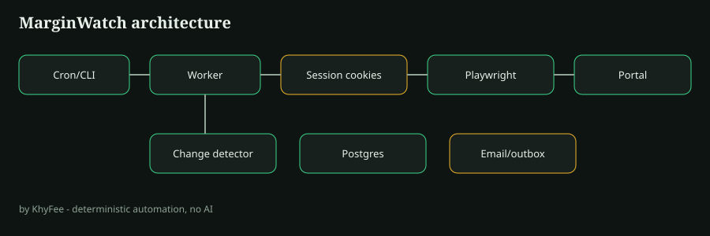

# MarginWatch

**B2B Supplier Portal Automator** by [KhyFee](https://github.com/KhyFee).

Playwright logs into supplier portals with **cookie session reuse**, diffs prices, and alerts when increases exceed **5%**. Deterministic automation — no AI.

Developed privately before this public release — commit history reflects open packaging, not a simulated multi-month timeline.

## Quick start

```bash
npm install
npx playwright install chromium
npm run demo
# inspect .marginwatch/outbox/*.eml and .marginwatch/store/
```

## Architecture



## Commands

- `marginwatch doctor` — env / data dir diagnostics
- `marginwatch run` — scrape configured portal
- `marginwatch demo` — portal + baseline + price bump + alert

## Stack

Node.js · Playwright · Supabase Postgres schema · Docker · Next.js status dashboard · Express dummy portal

## Limitations

Scrapers break when supplier UI changes. v0.1 demos use the included dummy portal only — do not point CI at third-party sites.

## License

MIT © KhyFee
